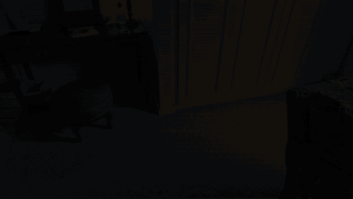
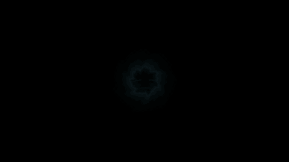
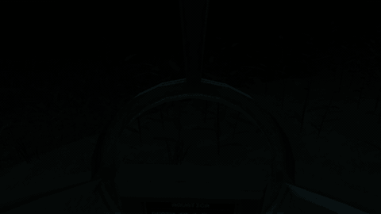
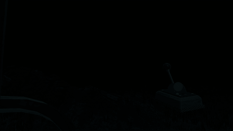
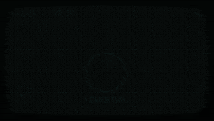
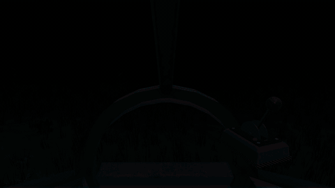
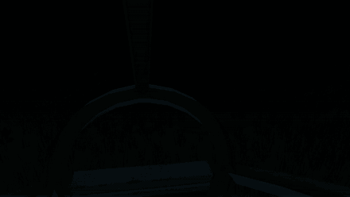
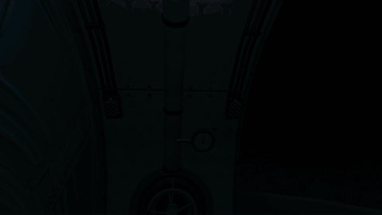
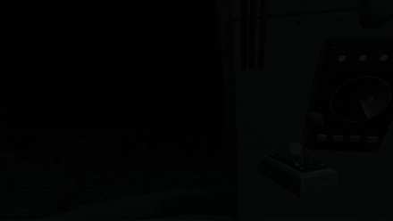

# Aquatica: Gameplay Breakdown

> *Open a portal on your floor. Dive. Bring the expedition home.*

**Genre:** mobile AR-to-VR submarine exploration and repair puzzle, played by walking around with the phone
**Engine:** Unity **6000.3**, URP 17, AR Foundation 6.6 + ARCore (Android)

> 🎞️ Every video in this document plays as a silent animated preview. Click a preview to open the full MP4.

---

## 1. Core loop

1. **Open** a gateway on your floor in AR and walk through it into the submarine's cockpit.
2. **Navigate** towards the nearest crates on the radar by looking where you want to go while holding the throttle.
3. **Recover** each crate with the magnet, balancing it by tilting the phone, and read what it held on the monitor.
4. **Repair** the systems that fail along the way before the cabin floods. Repeat until three Tide Crystals are aboard, then pass through the gate.

A dive is one sitting of roughly 10-15 minutes. The seafloor is seeded (seed 1337), so every dive has the same layout.

---

## 2. Augmented reality: the gateway

The game starts in an AR session. Plane detection looks for the floor; a water-ripple **placement area** (with bubbles and the prompt *"Dare brave the deep oceans?"*) is projected from the centre of the view onto upward-facing planes and glides along them as the phone moves. A tap anywhere anchors it with an `ARAnchor` and the **gateway** grows in with a springy overshoot.

🎬 [`github/videos/01_ar_portal.mp4`](github/videos/01_ar_portal.mp4). Scanning the floor, the ripple settling on open carpet, the tap, the gateway growing in, the walk through it, a look back at the room through the doorway, and the dive.

### 2.1 The one-way doorway

- A single-sided **portal mask** stamps the stencil buffer, and the underwater interior only renders where it is stamped, so the ocean is visible only through the **front** of the arch. From the side or behind, there is just a stone arch.
- Crossing the doorway from the front flips the stencil test: the interior (a large sphere around the doorway) now renders everywhere *except* the doorway, which keeps showing the room behind you.
- About 1 m past the doorway (0.6 m before the end of its 1.6 m corridor), an iris transition closes, the underwater world is generated while the screen is black, the camera feed and room lighting switch off, and the iris opens inside the cockpit.

---

## 3. The cockpit

The cockpit is placed so its floor is on your real floor and its bow faces the way you walked in. From then on the phone is a **tracked window into the cabin**: walk forward to the pilot's dome, turn round to the devices on the side walls.

🎬 [`github/videos/02_cockpit.mp4`](github/videos/02_cockpit.mp4). The first look around after the dive: the dome and the console, the radar and power grid on the right wall, the ballast valve, pressure gauge and interlock key switches on the left.

| Station | Where | What it does |
|---|---|---|
| Console screen | dome, low | Navigation mode, magnet prompt, fault page |
| Monitor | dome, high | Depth and heading, crate scans and logs, fault page |
| Radar | right wall | The 3 nearest crates and the gate within 150 m |
| Power grid | right wall | 8 toggle switches with status lights |
| Ballast valve | left wall | Wheel and pressure dial, mirrored by a wall gauge |
| Interlock | left wall, high | Two covered key switches, far apart |

- **Collision for your head.** `CameraWallBlocker` sweeps the camera as a 15 cm sphere; when the real player keeps walking into a wall, the whole XR rig is shifted back instead, and it is carried along with the moving sub.

---

## 4. Navigation

Stepping into the pilot zone in front of the seats makes the console show **HUMAN DETECTED! / ENTER NAVIGATION MODE**. A tap engages it and a throttle lever floats into the bottom of the view.

- **Hold the throttle** to drive; release and the sub coasts to a stop.
- **Heading** follows the direction you look. **Pitch** sets the climb, relative to a 12° "phone held low" neutral with a 7° dead zone: look further down to dive, level or up to climb.
- Top speed **3.6 m/s** (about 7 kn); the engine spools up over 1.6 s and turns at up to 18°/s.
- Leaving the pilot zone or turning more than 150° away from the bow for a second drops out of navigation mode.
- **Currents** ring the 180 m dive area: near the edge they push the sub back and the monitor shows *STRONG CURRENT* with where it comes from.

<table><tr><td width="50%"></td><td width="50%"></td></tr></table>

🎬 Videos:
* [`github/videos/03_navigation.mp4`](github/videos/03_navigation.mp4): tapping the console, taking the throttle and cruising to the nearest crate (the cruise at 1.5×).
* [`github/videos/08_the_deep.mp4`](github/videos/08_the_deep.mp4): a run along the seafloor towards a rock arch.

---

## 5. The expedition: crates, magnet and logs

**Ten crates** are buried across the seafloor. The radar shows only the three nearest (the closest brightest) plus the gate's beacon, and pings as its sweep passes the nearest one.

### 5.1 The magnet

When the hang point under the hull is within **5 m** of a crate horizontally, **6-16 m** above it and slow enough, the console offers the magnet. A tap opens a full-screen **magnet camera** styled as a CRT monitor.

- The magnet swings on its cable in a drifting current. **Tilt the phone** (held flat, screen up) to push it; the swing is calibrated to the gravity sensor, up to 30° for full push.
- While the magnet is over the lid, the target ring shrinks and the cable pays out; drift off and it winds back.
- Close enough, it **snaps on**, tears the crate out of the silt and winches it up, then the feed cuts to static.
- No fail state: the current eases off after 25 s and the magnet guides itself in after 60 s.

🎬 [`github/videos/04_magnet.mp4`](github/videos/04_magnet.mp4). Engaging the magnet, balancing it over the lid by tilting, the lock-on and recovery, then the monitor scanning the crate and showing a log.

### 5.2 What the crates hold

What a crate holds is decided **when it comes up**, not where it lies, so the story reads in order whichever way you go:

| Crate | 1 | 2 | 3 | 4 | 5 | 6 | 7 | 8 | 9 | 10 |
|---|---|---|---|---|---|---|---|---|---|---|
| Content | Log 1 | Log 2 | **Crystal 1** | Log 3 | Artifact | **Crystal 2** | Log 4 | **Crystal 3** | Artifact | Artifact |

The fifth log plays at the gate. If the dive passes **11 minutes** without all three crystals, the next crate holds one.

---

## 6. Faults and flooding

A **FaultDirector** breaks cockpit devices in waves; all faults in a wave break in the same frame. While anything is broken:

- The **helm locks**: navigation drops out and console taps do nothing.
- Both screens show the same red page: *!! SYSTEM FAULT !!*, one line per broken device with an arrow towards it from the pilot's seat, and *HELM LOCKED*.
- The cabin lights turn red, the device's own light blinks, and each device sounds its own klaxon.
- **The cabin floods** at 2.2 cm/s × the phase multiplier, +50 % per extra fault, paused while the magnet is busy. Fixing everything drains it at 10 cm/s; water reaching your eyes ends the dive (*HULL FLOODED*).

| Crates recovered | Time between waves | Difficulty | Faults per wave | Flood multiplier |
|---|---|---|---|---|
| 0-1 | none | 1 | 1 | 1 |
| 2 | 30-50 s (the first is always the radar) | 1 | 1 | 1 |
| 3-5 | 100-150 s | 1 | 1 | 1 |
| 6-8 | 70-100 s | 2 | 1-2 | 1.25 |
| 9-10 | 45-70 s | 3 | 2 | 1.5 |
| Gate open | 35-50 s, plus a double fault 2.5 s after it opens | 3 | 2 | 2 |

No fault starts during a magnet pickup or a crate reading, nor within 20 s after one.

### 6.1 The repairs

| Device | Repair | Difficulty 1 / 2 / 3 |
|---|---|---|
| **Radar** | Tap *PLAY ERR SEQ*, watch the four lights play a sequence, repeat it on the buttons. A wrong press or a 6 s pause replays it. | 5 / 6-7 / 8-9 notes |
| **Ballast valve** | The pressure drifts and surges both ways; turn the wheel to keep the needle in the middle green band until the hold timer fills (it drains outside the band). | hold 5 / 7 / 9 s |
| **Power grid** | Red lights mark the wrong switches; flip them back. Putting one right can knock another out 0.35 s later. | 2-3 / 3-4 / 4-5 wrong, 1 / 2 / 3 kickbacks max |
| **Interlock** | Both safety covers unlock. Open them, then turn both keys together; a released key springs back after a moment. | 1.2 / 0.8 / 0.45 s spring-back |

<table><tr><td width="33%"></td><td width="33%"></td><td width="33%"></td></tr></table>

🎬 Videos (all at difficulty 1):
* [`github/videos/05_radar_fault.mp4`](github/videos/05_radar_fault.mp4): the radar breaks, the fault page and red cabin, then the error sequence repeated.
* [`github/videos/06_flooding.mp4`](github/videos/06_flooding.mp4): a double fault (ballast valve and power grid). The water rises to about half a metre while the valve is held in the green and the switches are flipped back, then drains.
* [`github/videos/07_interlock.mp4`](github/videos/07_interlock.mp4): both covers flipped open and the two keys turned.

---

## 7. The way out

The **exit gateway** is the portal's arch scaled ×10.5, standing on the seafloor with a glowing seal across it. Three crystal clusters grow out of the stone; each wakes (blue glow, electric veins) as a Tide Crystal comes aboard, and the seal's light reaches the seafloor and the sub as it charges. With all three aboard, coming within **45 m** dissolves the seal, the final log plays on the monitor, and passing through ends the dive.

🎬 [`github/videos/09_the_gate.mp4`](github/videos/09_the_gate.mp4). The approach, the seal opening, the pass through it, and the ending card.

The ending card (*TRANSMISSION ENDS*) lists the logs and artifacts found and the dive time.
