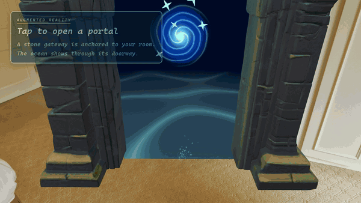

# Aquatica

**An AR ocean exploration experience**

*Open a portal on your floor. Dive. Bring the expedition home.*

**A mobile AR-to-VR submarine game: anchor a gateway in your room, walk through it into the cockpit of a deep-sea rescue sub, steer it by looking, fish buried crates out of the silt with a tilt-controlled magnet, and keep the failing systems alive until three Tide Crystals open the way out.**

▶️ **[Watch the full trailer (2 min)](GameplayBreakdown/github/AQUATICA_trailer_github.mp4)** · 📖 **[Full gameplay breakdown](GameplayBreakdown/GAMEPLAY_BREAKDOWN.md)**

<!-- For a playable trailer WITH SOUND inline: on github.com, edit this file and drag the <=10 MB
     trailer into the editor here; keep the generated user-attachments URL on its own line. -->

---

## About

Aquatica starts in augmented reality. You scan your floor, a ripple of water follows the centre of the view, and a tap anchors a stone gateway in your room. The ocean only shows through the front of its doorway. Walk through it and the room is gone: you are standing on the cabin floor of the submarine **Aquatica**, and the phone becomes your view of a cockpit you can physically walk around.

Out there, a lost expedition left **ten supply crates** buried on a seeded seafloor of trenches, rock arches, kelp and fish schools. The radar shows the three nearest. You steer by looking, lower a magnet by tilting the phone, and read what each crate holds on the monitor: expedition logs, artifacts, and the three **Tide Crystals** that wake the gate home. Meanwhile the sub's systems keep failing. Every fault locks the helm and floods the cabin until you walk to the device and repair it.

  

## Features

<table>
  <tr>
    <td width="50%"></td>
    <td width="50%"></td>
  </tr>
  <tr>
    <td><b>A portal on your floor.</b> AR plane detection finds the floor; a water ripple follows wherever the phone points and a tap anchors the gateway with a springy grow-in.</td>
    <td><b>A one-way doorway.</b> A stencil mask shows the ocean only through the front of the arch. Step through and turn round: your room is still there, framed by the doorway. A few steps on, the dive begins.</td>
  </tr>
  <tr>
    <td width="50%"></td>
    <td width="50%"></td>
  </tr>
  <tr>
    <td><b>Stand inside the sub.</b> The cockpit is lined up with where you stand, so you walk around it for real. Head-sized collision keeps you out of the walls.</td>
    <td><b>Steer with your gaze.</b> Tap the console for navigation mode and hold the floating throttle: the sub turns towards where you look and dives or climbs with your pitch.</td>
  </tr>
  <tr>
    <td width="50%"></td>
    <td width="50%"></td>
  </tr>
  <tr>
    <td><b>A tilt-controlled magnet.</b> Over a crate, the console offers the magnet. Tip the phone to swing it over the lid on a CRT feed; hold it there and it lowers, locks on and winches the crate up.</td>
    <td><b>A story in the crates.</b> Every crate is scanned on the monitor. The order is paced so five logs, three artifacts and three Tide Crystals tell the expedition's story in order.</td>
  </tr>
  <tr>
    <td width="50%"></td>
    <td width="50%"></td>
  </tr>
  <tr>
    <td><b>Faults lock the helm.</b> Red cabin lights, a klaxon per device, and both screens listing what broke with an arrow towards it. Waves get harder and come in pairs as the dive goes on.</td>
    <td><b>Repair while it floods.</b> Four minigames: a radar memory sequence, a ballast valve to hold in the green, a power grid that kicks switches back out, and a two-key interlock.</td>
  </tr>
</table>

### The dive

| The gate home | The deep |
|---|---|
|  |  |
| A sub-sized twin of the portal. Each Tide Crystal wakes one cluster on the arch; with all three the seal dissolves. | The cabin goes red and the radar garbles. Repeat its error sequence to get the helm back. |

## Cockpit systems

| Device | Fault | Repair (difficulty 1 / 2 / 3) |
|---|---|---|
| Radar | Screen garbles, contacts vanish | Tap **PLAY ERR SEQ**, then repeat a 5 / 6-7 / 8-9 light sequence |
| Ballast valve | Pressure surges both ways | Turn the wheel to hold the needle in the green for 5 / 7 / 9 s |
| Power grid | 2-3 / 3-4 / 4-5 switches wrong | Flip them back; a fixed switch can be knocked out again (35 / 45 / 55 % chance) |
| Interlock | Safety covers unlock | Open both covers and turn both keys before the first springs back (1.2 / 0.8 / 0.45 s) |

Any active fault locks the helm and floods the cabin at 2.2 cm/s (faster with two faults and later in the dive). Repairing everything drains it. Water at eye level ends the dive.

## Controls

| AR / cockpit | | Expedition | |
|---|---|---|---|
| Look and walk | move the phone | Navigation mode | tap the console |
| Anchor the gateway | tap the screen | Thrust | hold the throttle |
| Use a device | tap / drag it | Steer, dive, climb | look where you want to go |
| Two-key interlock | tap both keys | Magnet | tap the console over a crate, then tilt the phone |

In the editor the mouse stands in for touch and WASD / arrow keys for the phone tilt.

## Under the hood

- **AR placement.** `PortalPlacementController` raycasts the screen centre against AR Foundation planes, smooths the ripple along them and anchors the gateway with an `ARAnchor`.
- **One-way portal.** `PortalTraversal` flips the interior's stencil test when the camera crosses the doorway from the front, so the ocean becomes the world and the doorway shows the room.
- **Tracked camera in a moving sub.** `UnderwaterWorld.Enter` aligns the cockpit to the player; `CameraWallBlocker` sweeps the head as a sphere and shifts the whole XR rig back from walls, and carries it with the sub.
- **Gaze steering.** `SubmarineMotor` turns towards the camera's heading and maps pitch (relative to a 12° "phone held low" neutral) to climb, with currents pushing back at the edge of a 180 m area.
- **Procedural world.** Seeded seafloor tiles, rock arches with convex collider chunks, seabed props and fish schools with boids-style agents.
- **Expedition pacing.** `ExpeditionDirector` decides crate contents on capture so the story reads in order; `FaultDirector` schedules fault waves by crates recovered; `CabinFlood` fits a water surface to the hull.
- **Pixel screens.** Cockpit screens are drawn into a `PixelCanvas` with a bitmap font and shown through a phosphor-dot, scanline and glow shader.

Gameplay scripts live in [`Assets/Aquatica/Scripts/`](Assets/Aquatica/Scripts): `AR` (placement, portal, dive), `Navigation`, `Cockpit` (devices and screens), `Expedition` (crates, magnet, faults, flooding, ending), `Underwater` (seafloor, arches, fish), `Audio` and `Player`.

## Getting started

1. Clone the repository (Git LFS) and open it with **Unity 6000.3** (URP 17, AR Foundation 6.6, ARCore).
2. Switch to **Android**, connect an ARCore-capable phone and build `Assets/Scenes/ARPlaneDetection.unity`. Ready-made APKs are attached to the [Releases](https://github.com/wall-hacker/Aquatica/releases).
3. Point the phone at the floor, tap to place the gateway and walk through it.

## Media

- 🎬 [Trailer](GameplayBreakdown/github/AQUATICA_trailer_github.mp4) and per-mechanic demo clips in [`GameplayBreakdown/github/videos`](GameplayBreakdown/github/videos). Each clip also plays inline as an animated preview in the [gameplay breakdown](GameplayBreakdown/GAMEPLAY_BREAKDOWN.md) ([`previews/`](GameplayBreakdown/github/previews))
- 🖼️ Store-style screenshots in [`GameplayBreakdown/screenshots`](GameplayBreakdown/screenshots)
- 📖 A detailed design breakdown in [`GameplayBreakdown/GAMEPLAY_BREAKDOWN.md`](GameplayBreakdown/GAMEPLAY_BREAKDOWN.md)

## Credits

- **Music (trailer):** "Exploration Theme" by Cleyton Kauffman, [OpenGameArt](https://opengameart.org/content/exploration-theme), CC0.
- **Fish models:** The fish pack, the submarine, gateway and seabed models are third-party assets covered by their own licences.
